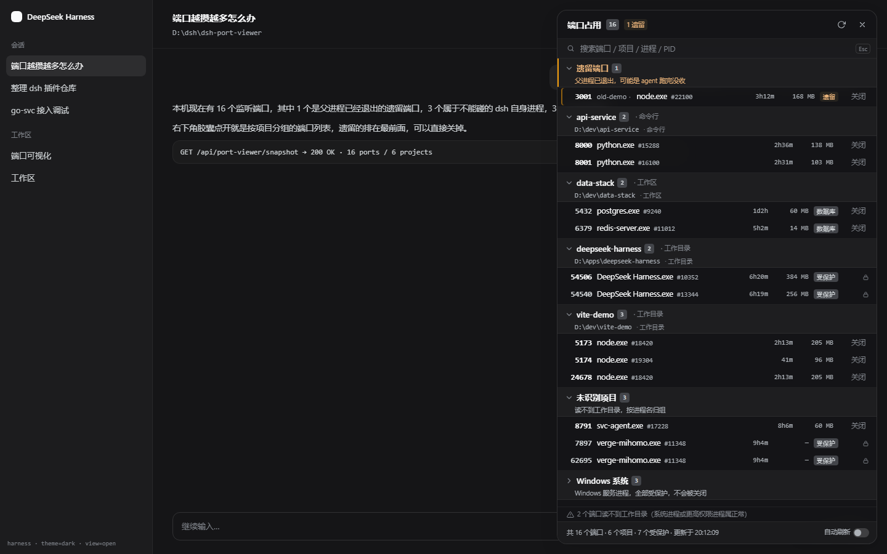
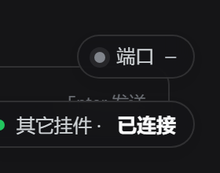
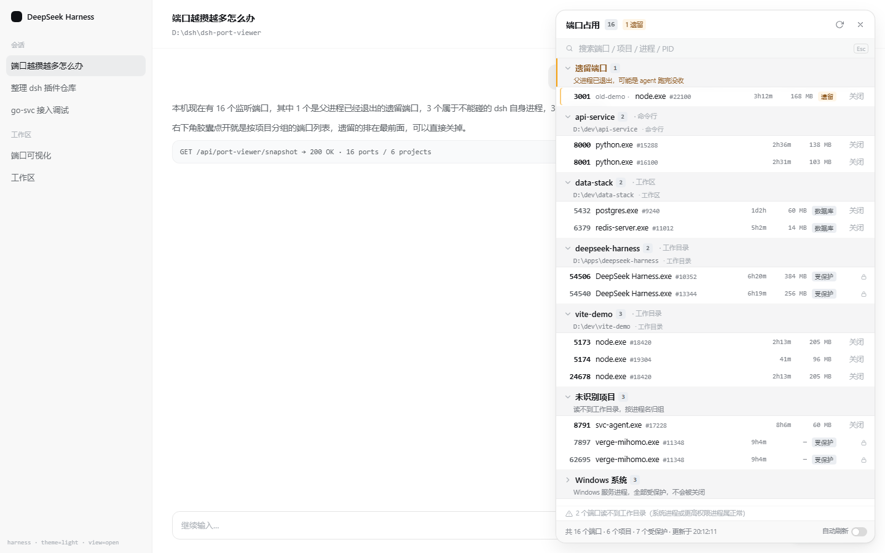

# dsh-port-viewer · 端口可视化

给 **DeepSeek Harness（dsh）** 桌面端加一个端口占用面板：右下角一个胶囊，点开就是
「谁在占端口、它属于哪个项目」，不需要的当场关掉。

> A dsh (DeepSeek Harness) plugin: a bottom-right pill that opens a slide-over panel listing
> every TCP listener on this machine, **grouped by the project it belongs to**, with a guarded
> kill button. Built for the "my agents left a dozen dev servers running again" problem.
> Zero dependencies, no build step, no background daemon.

它解决的是这个问题：用 agent 做项目，`npm run dev`、`python -m uvicorn` 之类的开发服务器
跑完没人收，端口越攒越多；打开任务管理器只看到一堆 `node.exe`，根本分不清哪个是哪个项目的。



## 它长什么样

- **右下角胶囊**：`端口 12`，有「父进程已退出」的遗留端口时变琥珀色并提示 `· 3 遗留`。
  首次点开之前不扫描（悬停会说明），避免每次打开 dsh 都去拉起 PowerShell。
- **右侧抽屉**：端口按项目分组，组头是项目名 + 路径 + 端口数，组里每条是
  端口号 / 进程名 / PID / 已运行时长 / 内存 / 徽标。
- 分组顺序固定：**遗留端口 → 用户项目（按名排序）→ 未识别项目 → Windows 系统（默认收起）**。
  遗留分组带一句「父进程已退出，可能是 agent 跑完没收」；系统进程收在最后一组，不占视线。
- 点 `关闭` → 行内变成 `确认关闭 / 取消`，3 秒倒计时自动还原；**没有全局弹窗**。
- 明暗主题跟随 dsh，颜色全部来自 `--dsw-*` 设计变量。




## 「端口属于哪个项目」是怎么判出来的

这是本插件的重点，不是简单列 PID。判定按可信度依次回退，每条端口都会标出来源：

| 优先级 | 依据 | 说明 |
| --- | --- | --- |
| 1 | 进程**工作目录** | 从 cwd 向上找项目标志物（`.git` / `package.json` / `pyproject.toml` / `Cargo.toml` / `go.mod` / `pom.xml` / `*.csproj` / `composer.json` …） |
| 2 | **命令行**里的绝对路径 | 覆盖 `node …\node_modules\vite\bin\vite.js`、`--cwd=` 这类；会剥掉 `node_modules` 之前的部分 |
| 3 | **父进程链** | cwd 读不到时（权限/系统进程）向上最多 4 层找第一个有 cwd 的祖先 |
| 4 | **DSH 工作区表** | 读 `$DSH_HOME/storages/workspace.json` 里登记的工作区路径做最长前缀匹配 |
| 5 | 进程所在目录 | 装好就常驻的程序（代理内核、本地服务、dsh 自身）用安装目录当组名 |
| 6 | 同名可执行文件 | 身份被权限挡住时，用其它进程里同名 exe 的目录认领（例：`verge-mihomo.exe` → `Clash Verge`） |

都推不出来时不会丢端口：属于 Windows 系统的一组收进「Windows 系统」，其余进「未识别项目」。
`<DSH_HOME>` 与 `profiles\<name>` 不算项目根（否则 dsh 会归到一个叫 `desktop` 的组）；
dsh 自身进程显示为 **DeepSeek Harness（本界面）**。

典型场景（作者本机实测，均为真实进程）：一个 `vite` dev server 即使**从别的目录启动**，
也能靠命令行里的 `…/<项目>/node_modules/vite/…` 归到项目；`python -m uvicorn` 靠 cwd 归到项目；
`verge-mihomo.exe`（SYSTEM 账户、读不到 cwd）靠同名 exe 认领归到 Clash Verge。

Windows 上没有现成的「取别的进程工作目录」API，这里用 PEB 读取
（`NtQueryInformationProcess` + `ReadProcessMemory`）拿 `CurrentDirectory`；
读不到（系统进程 / 更高权限）就退化成上面第 2~6 级，不会因此漏掉端口。

## 安全：什么不会被关

「关闭」是破坏性动作，而且「读端口清单」本身就会暴露命令行，所以宿主侧有三道关：

1. **会话鉴权**：两条路由复用 **dsh 自己的会话 cookie**（`ctx.get('connection').authorizeIndex`，
   与 `/api` 桥、index 服务是同一个校验）。桌面壳把 `/api/*` 转发给宿主时会带上这个 cookie，
   所以正常界面天然带凭证，而本机的其它进程（别的登录用户、脚本）没有。
   *为什么不用插件自己发令牌*：最初就是那样做的 —— 用 `webServer.tapIndex` 把令牌注水进
   index.html。它在浏览器版 dsh 里能跑，但**桌面端结构上不可能成立**：桌面壳对
   `dsh-app://app/` 的主文档是直接从 `app.asar/renderer` 读盘返回的，只有 `/api/*`、
   `/plugins/*` 才转给宿主，所以 index 注入在桌面端永远不会执行 —— 强制令牌 = 面板 100% 401
   （实测踩过）。宿主没有 `connection` 服务时这条自动跳过，退回同源 + CSRF。
2. **请求形态**：跨源请求、非 `application/json` 的表单请求一律拒绝 —— 任意网页没法借你的浏览器
   关你的进程。
3. **目标复核**：前端拿到的 `killable` 只是提示，真正的判定在 `POST /api/port-viewer/kill` 里，
   而且执行前会用**绕过缓存的新快照**重新核对「这个端口此刻是否仍属于这个 PID」（PID 复用即拒绝）。
   `fresh` 采集失败时直接拒绝，绝不拿旧快照授权。以下一律拒绝：
   - `pid <= 4`（System / Idle）、已知系统进程名、`%SystemRoot%` 下的可执行文件；
   - **dsh 自己**：宿主进程、同 exe 的整个 Electron 进程树（主进程/renderer/GPU/subprocess）；
   - **正在承载当前界面的那个端口**（关掉等于把界面拔线）；
   - **身份读不到的进程**（典型是 SYSTEM 账户拉起的服务）：`taskkill` 对它本来就是 AccessDenied。

另外，快照里的命令行会抹掉 `sk-…`、`ghp_…`、`*_PASSWORD=…`、`--token xxx`、`-p xxx`、
`Bearer …`、URL 内嵌凭据等常见形态；`taskkill` 之后用「进程还在不在」判定成败，
而不是相信 taskkill 的退出码（128 既可能是「没有这个进程」也可能是「拒绝访问」）。

界面里受保护的行显示锁图标与原因（例如「这是当前界面的端口，关掉会把界面弄掉」），没有关闭按钮。
完整威胁模型见 [SECURITY.md](SECURITY.md)。

## 安装（desktop profile）

需要 Windows（端口采集依赖 `netstat` 与 PowerShell 5.1）以及装在桌面端的 dsh。

```powershell
powershell -ExecutionPolicy Bypass -File scripts\install-desktop.ps1
```

脚本做三件事，全部可逆（改动前的 profile `package.json` / `cordis.patch.yml` 会备份到
`.backups\`，已 gitignore）：

1. 在 profile 的 `package.json` 里把 `dsh-port-viewer` 加进 `dsh.profile.bundles` 并登记 `file:` 依赖；
2. 在 profile 的 `node_modules` 下建**目录联接**指向本仓库（等价于 `pnpm add file:`，但不触动已有安装）；
3. 自检：包名已登记、`lib/index.js` 可经联接访问。

dsh 数据根默认取 `$env:DSH_HOME`，否则 `~\.dsh`。如果你的启动脚本设了别的 `DSH_HOME`
（例如放在 D 盘），显式传进去：

```powershell
powershell -ExecutionPolicy Bypass -File scripts\install-desktop.ps1 -DshHome D:\your\dsh-home -DryRun
```

`-DryRun` 只打印将要做什么。**装完要重启 dsh 桌面端**：cordis 的 profile 图在进程启动时组装，
没有热挂载新插件的能力。

> 官方等价做法（会跑一次 pnpm）：`dsh plugin --profile desktop add file:<本仓库绝对路径>`

## 卸载

```powershell
powershell -ExecutionPolicy Bypass -File scripts\uninstall-desktop.ps1
```

删联接、从 `bundles` 与依赖里摘掉，重启后彻底消失；也可以直接还原备份的 `package.json`。
不重启也能立刻止血：在 profile 的 `cordis.patch.yml` 里对本行加 `disabled: true`。

## 配置（可选）

在 profile 的 `cordis.patch.yml` 里按行 id 覆盖：

```yaml
- id: port-viewer
  name: 'dsh-port-viewer'
  config:
    protectSystem: true     # 关掉就等于允许杀系统进程，别关
    requireSession: true    # 要求请求带 dsh 的会话 cookie（见「安全」第 1 条）
    ttlMs: 1200             # 快照缓存时间；连点刷新不会反复拉起 PowerShell
    maxTargets: 128         # 单次 kill 请求最多几个目标
    snapshotTimeoutMs: 15000
```

## 实现要点

- **零依赖、无构建**：宿主半边 `lib/index.js`（cordis 插件 + 两条同源路由），浏览器半边
  `lib/client.js`（classic script，`position: fixed` 注入，样式全部用 dsh 自己的 `--dsw-*`
  设计变量）。不新增 npm 依赖，卸载后不残留。
- **采集**：`lib/collect.js` 拉起一次 Windows PowerShell 跑 `lib/snapshot.ps1`
  （`netstat -ano -p TCP` + `Get-CimInstance Win32_Process` 全表 + PEB 读 cwd），
  UTF-8 无 BOM JSON 经临时文件回传；一次全量快照约 1 秒。归属推断在
  `lib/projects.js`，是纯函数，可单测。
- **不需要常驻进程**：插件只在 dsh 运行时存在；不装服务、不写注册表、不开机自启。平时不扫描，
  只有你点开面板（或打开自动刷新）时才采一次。
- **整个 client.js 包在 IIFE 里，绝不污染全局**：页面里还有别的 classic script 插件，顶层
  同名工具函数（例如都叫 `el()`）会互相覆盖 —— 实测过这种冲突会让**对方插件的挂件丢掉全部
  内联样式、从右下角消失**。所以本文件不向 `window` 泄漏任何符号，
  `test/client-scope.test.mjs` 用 `node:vm` 空沙箱把这件事锁死。
- **右下角自动避让**：胶囊不硬钉 `bottom:60px`，而是量出右下角已有挂件的盒子、排在它上方
  （量不到才退回 60px）。窗口缩放、每次展开都会重新量 —— 插件加载顺序不保证。
  需要让位给别的挂件时，把它的容器 id 加进 `lib/client.js` 的 `BOTTOM_RIGHT_ANCHOR_IDS`。

## 验证

- `node --test test/index.test.mjs` —— 宿主安全闸门与 HTTP 语义（**22/22**：会话鉴权的
  放行/拒绝/异常兜底、跨源拒绝、受保护目标、PID/端口复核、opaque 进程、Electron 宿主下的
  dsh 进程树、凭据抹除的 10 种真实形态、taskkill 的「活着就判失败」、采集失败降级、
  缓存与并发合并）。
- `node --test test/collect.test.mjs` —— 采集与归属推断（**39 个用例 / 38 通过 / 1 默认跳过**：
  cwd/命令行/父链/工作区回退、孤儿判定、多绑定合并、降级快照、系统组合并、UNC 拒绝；
  跳过的是需要真机的 `PV_REAL=1` 用例）。
- `node --test test/client-scope.test.mjs` —— 浏览器半边作用域回归（**3/3**）：`node:vm`
  空沙箱跑 client.js，断言不留全局符号、模块契约正确、`apply` 走 `ctx.effect`、
  胶囊靠 class（而不是 style 属性）拿样式、dispose 后 DOM 清干净。
- `scripts/verify-isolated.ps1 -Phase full` —— 起一个**隔离实例**（独立 `DSH_HOME` 与
  `portverify` profile，端口 3099），用无头 Edge + CDP 跑端到端断言：插件进入 boot 图、
  **匿名请求 / 伪造 cookie 都被 401 拒绝**、自己起的牺牲监听器真的被 kill 掉且端口释放、
  受保护端口被拒（`error=protected`）且界面存活、抽屉打开后 dsh 界面仍可点击、明暗两套截图。
  不碰你正在用的桌面端；结束断言端口释放、无遗留进程。
- `test/panel-harness.html` —— 不启 dsh 也能看面板：逐字内嵌 dsh 真实的两套 `--dsw-*` 变量，
  mock 掉加载器与宿主，用固定快照渲染 9 种状态，并自带几何/对比度自检。

设计细节（为什么是 DOM 注入、为什么整份采集交给一次 PowerShell、状态机怎么走）见
[docs/DESIGN.md](docs/DESIGN.md)。

## 已知限制

- **必须重启桌面端**才生效（见「安装」）。
- 只在 Windows 上可用：`netstat`、`Get-CimInstance`、PEB 读取都是 Windows 路径。
- **会读其它进程的内存**：为了拿工作目录，插件对其他进程调用 `OpenProcess` +
  `ReadProcessMemory`（只读 PEB 里的 `CurrentDirectory`，不扫别的数据）。这是 EDR 眼里的
  敏感行为；如果你不接受，可以在 profile 配置里把它关掉（`snapshot.ps1 -SkipCwd` 等价能力
  目前只在库层面暴露，未接成配置项）。
- PEB 偏移只支持 x64；32 位 PowerShell 下会跳过 cwd 读取（不会读错内存），代价是归属退化为
  「命令行/安装目录」。
- 取不到工作目录的进程（系统服务、更高权限进程）只能靠命令行与安装目录推断，可能落到
  「Windows 系统」或「未识别」组 —— 这类端口本来也不该被关。
- 快照里读不到命令行时（部分系统进程）只显示进程名与 PID。
- 一次全量快照约 1 秒（开发机实测；慢机器上会更久，采集超时默认 15 秒）。
- 关闭用 `taskkill /T /F` 连带子进程：dev server 常是 `npm` → `node` 两层，只杀父进程会留下
  占着端口的孤儿。
- 只统计 TCP 监听端口；UDP 服务（DNS、部分游戏/流媒体）不在列表里。

## 目录结构

```
lib/index.js      宿主：cordis 插件入口、两条同源路由、kill 安全闸门
lib/collect.js    采集：spawn PowerShell、超时回收、读回 JSON
lib/snapshot.ps1  PowerShell：netstat + WMI + PEB 读工作目录
lib/projects.js   端口→项目推断（纯函数，可单测）
lib/client.js     浏览器半边：胶囊 + 抽屉（classic script，零依赖）
scripts/          安装 / 卸载 / 隔离实例验证
test/             单测、fixtures、面板 harness、E2E 驱动
docs/             设计说明与截图
```

## License

MIT，见 [LICENSE](LICENSE)。安全问题请先读 [SECURITY.md](SECURITY.md)。
